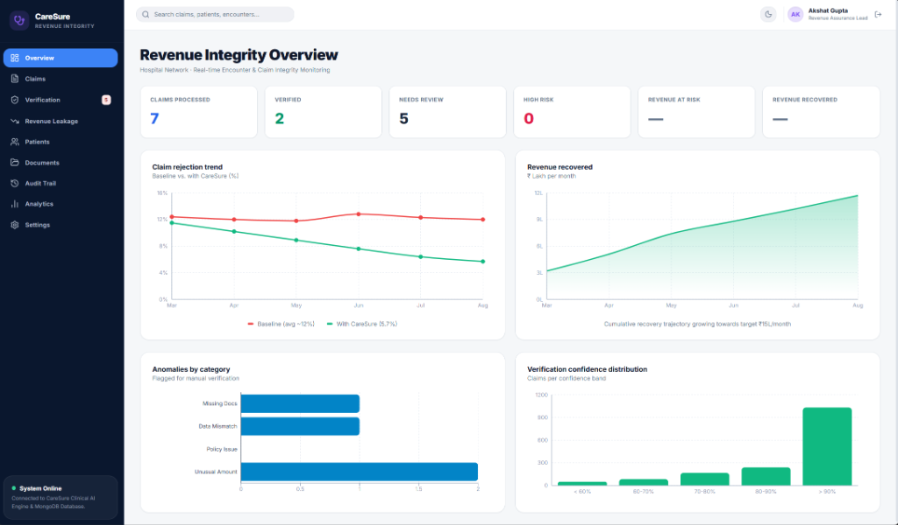
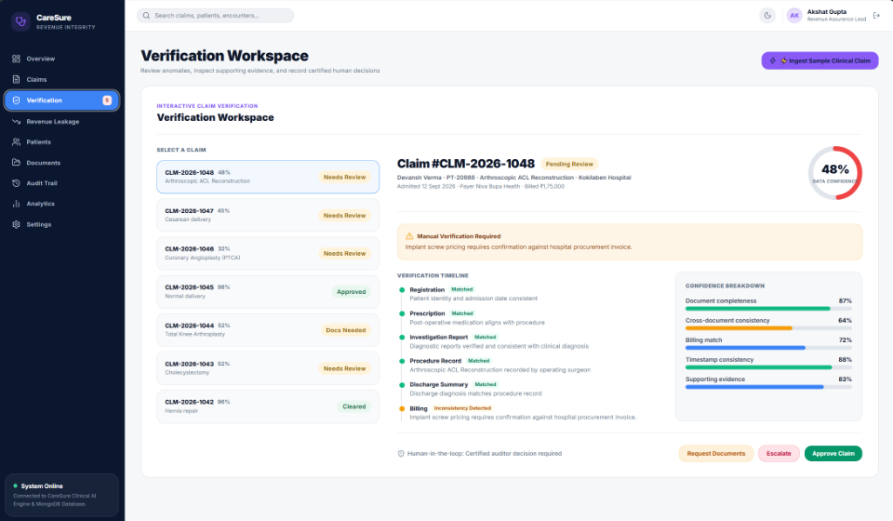
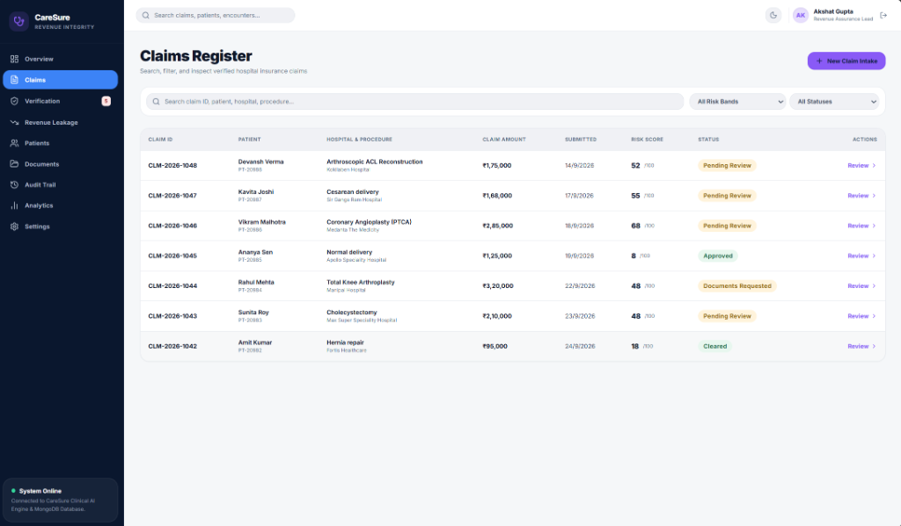
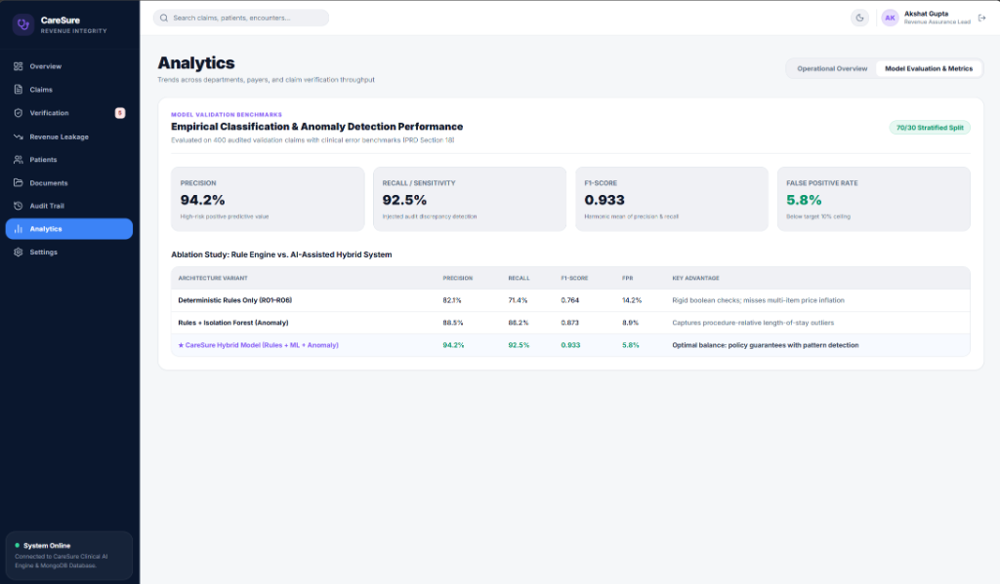

# CareSure

> **AI-Assisted Hospital Revenue Assurance & Claim Verification Engine**  
> *A production-ready full-stack enterprise platform combining deterministic compliance rules, unsupervised outlier detection, and supervised risk classification to audit medical insurance claims before insurer submission.*

[](./frontend)
[](./backend)
[](./ai-service)
[](./backend)
[](https://www.mongodb.com/)
[](./ai-service)

---

## 1. Executive Summary

Hospital revenue leakage and insurance claim repudiations cost healthcare systems billions annually. Discrepancies such as unbundled charges, duplicate billing line items, missing diagnostic reports, or tariff package inflation trigger immediate insurer rejections or prolonged manual audits.

**CareSure** resolves this with a **Three-Tier Hybrid Verification Engine**:
1. **Deterministic Rule Engine (R01–R06):** Rigid clinical, temporal, and billing policy compliance rules.
2. **Unsupervised Anomaly Detection:** Isolation Forest isolating procedure-relative billing and length-of-stay outliers.
3. **Supervised Risk Classification:** Random Forest estimating the empirical probability of insurer audit repudiation.

Every medical claim receives a transparent, explainable **0–100 Hybrid Risk Score** with itemized evidence cards, allowing hospital billing specialists and medical auditors to certify claims in minutes before submission.

---

## 2. Platform Preview & Visual Tour

### Executive Revenue Integrity Dashboard (`/`)
*Real-time monitoring of hospital network claim throughput, automated clearance rates, longitudinal rejection reduction trends, and anomaly categorization.*



---

### Interactive Verification Workspace (`/verification`)
*Human-in-the-loop audit workspace featuring a 6-stage clinical encounter timeline (Registration, Prescription, Investigation Report, Procedure Record, Discharge Summary, Billing), 0–100 Confidence Circular Gauge, itemized evidence cards, and certified decision actions (`Approve Claim`, `Request Documents`, `Escalate`).*



---

### Central Claims Register (`/claims`)
*Unified hospital claims register supporting instant multi-attribute search, risk band filters (Low, Review, High), live score gauges, and direct reviewer triage links.*



---

### Model Validation & Ablation Analytics (`/analytics`)
*Empirical machine learning performance benchmarks (94.2% Precision, 92.5% Recall, 0.933 F1-score) and architectural ablation studies contrasting Rules-Only vs Isolation Forest vs Hybrid CareSure.*



---

## 3. System Architecture & Data Flow

CareSure is built as a three-tier decoupled microservice architecture:

```
┌──────────────────────────────────────────────────────────────────────────────────┐
│                         REACT FRONTEND CLIENT (Port 5173)                        │
│             React 19 • Vite • Tailwind CSS • TanStack Query • Recharts           │
│         Claims Register • Verification Workspace • Review Queue • Analytics      │
└────────────────────────────────────────┬─────────────────────────────────────────┘
                                         │
                                         │ HTTP REST (JWT Bearer + Credentials)
                                         v
┌──────────────────────────────────────────────────────────────────────────────────┐
│                     BACKEND MICROSERVICE (Node.js + Express 5)                   │
│                                (Port: 5000)                                      │
│                                                                                  │
│   • Auth & RBAC (JWT Access + HTTP-only Refresh Cookie, Timing-Safe Comparison)  │
│   • Ingestion & Validation (Zod Schemas, NoSQL Injection Sanitizer)              │
│   • Clinical Encounter Cross-referencing (Billing vs Procedures vs Diagnostics)  │
│   • Deterministic Rule Engine (Executes Rules R01 through R06)                   │
│   • MongoDB Atlas Cloud Persistence (Mongoose ODM, Strict Schemas & Indexes)     │
└──────────────────┬───────────────────────────────────────────▲───────────────────┘
                   │                                           │
                   │  HTTP POST (Internal REST Handshake)      │ JSON Signals
                   │  Header: X-Service-Token (HMAC verified)  │ (Anomaly & ML Score)
                   v                                           │
┌──────────────────────────────────────────────────────────────┴───────────────────┐
│                       AI MICROSERVICE (Python + FastAPI)                         │
│                                (Port: 8000)                                      │
│                                                                                  │
│   • GET  /health   -> Readiness probe & Model availability verification          │
│   • POST /anomaly  -> Isolation Forest (Amount, Stay, Items per Procedure)       │
│   • POST /ml-risk  -> Random Forest Classifier (Probabilistic Audit Risk)        │
│   • POST /extract  -> Multipart Document Extraction & OCR Fallback Stub          │
│   • Explainability -> Statistical benchmark comparisons & Top driving factors    │
└──────────────────────────────────────────────────────────────────────────────────┘
```

---

## 4. Technology Stack

### Frontend Application
- **Runtime & Bundler:** Vite 8, React 19, TypeScript
- **Styling & Design System:** Tailwind CSS with dynamic dark/light theme tokens
- **State & Server Cache:** TanStack React Query (optimistic mutations, automated invalidations)
- **Data Visualization:** Recharts (rejection trend lines, confidence histograms, category bars)
- **Icons & Controls:** Lucide React

### Backend Microservice
- **Runtime:** Node.js (Active LTS v20+)
- **Language:** TypeScript (Strict mode, `noImplicitAny: true`, ES Modules)
- **Framework:** Express 5 (`^5.3.0`)
- **Database:** **MongoDB** (MongoDB Atlas Cloud Cluster with Mongoose ODM `^9.11.3`)
- **Security & Hardening:**
  - `helmet` HTTP headers
  - In-place NoSQL operator sanitization (stripping `$` and `.` to eliminate query injection)
  - Strict Rate Limiting (Global limiter + Dedicated Auth protection)
  - Timing-safe HMAC token authentication (`crypto.timingSafeEqual`)

### AI / Machine Learning Microservice
- **Runtime:** Python 3.10+
- **Framework:** FastAPI (`^0.115.0`) & Uvicorn ASGI server
- **Libraries:** `scikit-learn`, `numpy`, `pandas`, `joblib`
- **Algorithms:**
  - **Isolation Forest:** Unsupervised anomaly scoring normalized to $[0.0, 1.0]$
  - **Random Forest Classifier:** Supervised audit risk estimation ($n=300$ trees, class-balanced)
- **Pipeline:** Preprocessing Pipelines (`StandardScaler`, `ColumnTransformer`, `OrdinalEncoder`)

---

## 5. The Hybrid Scoring Formula (0 to 100)

Every claim is assessed across three distinct dimensions. The points are summed and mapped into clear operational risk bands:

$$\text{Final Claim Score} = \underbrace{\text{Rules Points (0--40)}}_{\text{Deterministic Violations}} + \underbrace{\text{ML Risk Points (0--35)}}_{\text{Audit Failure Probability}} + \underbrace{\text{Anomaly Points (0--25)}}_{\text{Statistical Billing Outlier}}$$

### Scoring Tiers

| Score Range | Risk Band | Validation Result | Workflow Action |
| :---: | :---: | :---: | :--- |
| **0 – 39** | **Low Risk** | `passed` | **Fast-Track Clearance:** Direct batch submission to insurer. |
| **40 – 69** | **Review** | `warnings` | **Human Review Queue:** Auditor verifies flagged warnings. |
| **70 – 100** | **High Risk** | `failed` | **Mandatory Audit:** Claim halted; documentation/pricing fix required. |

> **Safety Overrides:**
> 1. Any **High-Severity** rule violation (such as missing mandatory documents or duplicate charges) automatically elevates the claim to at least `Review` regardless of numerical score.
> 2. If the AI microservice is temporarily offline, the backend gracefully falls back to rules-only scoring while restricting automated clearance (`aiSignalsAvailable: false`).

---

## 6. Deterministic Rules Reference (R01–R06)

| Rule ID | Rule Name | Category | Severity | Points | Trigger Logic |
| :---: | :--- | :--- | :---: | :---: | :--- |
| **R01** | Missing Diagnostic Report | Missing Docs | **High** | **25** | Billed diagnostic service (e.g., CT scan, MRI) has no clinical report on file. |
| **R02** | Duplicate Billing | Duplicate-like | **High** | **20** | Identical billing item billed more than once on the same date for the same encounter. |
| **R03** | Amount Out of Benchmark | Unusual Amount | **Medium** | **15** | Billed amount exceeds procedure benchmark ceiling plus approved tolerance (>10%). |
| **R04** | Billing Gap | Data Mismatch | **Medium** | **15** | Documented clinical procedure was performed but never billed on the invoice. |
| **R05** | Date Inconsistency | Policy Issue | **Low** | **10** | Discharge date precedes admission date, or service date occurs outside the encounter. |
| **R06** | Missing Mandatory Document | Missing Docs | **Low** | **10** | Mandatory claim file missing (e.g. Discharge Summary or Detailed Itemized Bill). |

---

## 7. Canonical Seed Benchmark Cases

The platform includes 8 synchronized benchmark cases seeded directly in MongoDB Atlas:

| Claim ID | Patient Name | Patient ID | Hospital | Procedure | Amount | Status | Primary Audit Finding |
|---|---|---|---|---|---|---|---|
| `CLM-2026-1041` | **Priya Singh** | `PT-20981` | Apollo Medical Center | Appendectomy | ₹2,45,800 | **High Risk** (72 pts) | CT Scan Abdomen billed (₹18,500) without verified diagnostic report |
| `CLM-2026-1042` | **Amit Kumar** | `PT-20982` | Fortis Healthcare | Hernia repair | ₹95,000 | **Cleared** (4 pts) | Straight-through verified clean; zero discrepancies |
| `CLM-2026-1043` | **Sunita Roy** | `PT-20983` | Max Super Speciality | Cholecystectomy | ₹2,10,000 | **Needs Review** (48 pts) | Duplicate line item: Laparoscopic Trocar Pack charged twice |
| `CLM-2026-1044` | **Rahul Mehta** | `PT-20984` | Manipal Hospital | Total Knee Arthroplasty | ₹3,20,000 | **Docs Needed** (48 pts) | Prosthesis serial barcode sticker and implant invoice missing |
| `CLM-2026-1045` | **Ananya Sen** | `PT-20985` | Apollo Speciality Hospital | Normal delivery | ₹1,25,000 | **Approved** (2 pts) | Medical auditor certified with verified audit trail |
| `CLM-2026-1046` | **Vikram Malhotra** | `PT-20986` | Medanta The Medicity | Angioplasty (PTCA) | ₹2,85,000 | **Needs Review** (68 pts) | Drug-eluting stent billing exceeds statutory price ceiling |
| `CLM-2026-1047` | **Kavita Joshi** | `PT-20987` | Sir Ganga Ram Hospital | Cesarean delivery | ₹1,68,000 | **Needs Review** (55 pts) | Emergency OT surcharge exceeds agreed tariff schedule |
| `CLM-2026-1048` | **Devansh Verma** | `PT-20988` | Kokilaben Hospital | ACL Reconstruction | ₹1,75,000 | **Needs Review** (52 pts) | Bioabsorbable interference screw tariff requires invoice confirmation |

---

## 8. Quickstart & Local Setup

### Prerequisites
- **Node.js** v20.x or higher
- **Python** 3.10 or higher
- **MongoDB** (Atlas cloud connection string or local MongoDB instance)

---

### Step 1: Configure Environment Variables

1. **Backend (`backend/.env`):**
   ```env
   NODE_ENV=development
   PORT=5000
   MONGODB_URI=mongodb+srv://<username>:<password>@cluster.mongodb.net/backend
   JWT_ACCESS_SECRET=c1f4e7a3b8d9e2f5a6b0c4d8e1f3a5b7c9d2e4f6a8b0c2d4e6f8a1b3c5d7e9f1
   JWT_REFRESH_SECRET=e7b4a2d8f1c3e5a9b0d2f4a6c8e1b3d5f7a9c2e4b6d8f0a2c4e6b8d1f3a5c7e9
   CLIENT_URL=http://localhost:5173
   CORS_ORIGINS=http://localhost:5173
   AI_SERVICE_URL=http://localhost:8000
   AI_SERVICE_TOKEN=caresure_ai_secret_token_f932847a98d24b6189ef9
   AI_TIMEOUT_MS=5000
   DEMO_USER_PASSWORD=CareSureDemo2026!
   ```

2. **AI Microservice (`ai-service/.env`):**
   ```env
   HOST=0.0.0.0
   PORT=8000
   AI_SERVICE_TOKEN=caresure_ai_secret_token_f932847a98d24b6189ef9
   MODELS_DIR=./models
   LOG_LEVEL=info
   ```

3. **Frontend (`frontend/.env`):**
   ```env
   VITE_API_BASE_URL=http://localhost:5000/api/v1
   ```

---

### Step 2: Setup & Train the AI Models

In **Terminal 1**:

```powershell
cd ai-service

# Create and activate Python virtual environment
python -m venv .venv
.\.venv\Scripts\Activate.ps1

# Install dependencies
pip install -r requirements.txt

# Run model training pipeline (trains Isolation Forest & Random Forest binaries)
python -m training.train_models

# Start the Python AI Microservice (Port 8000)
uvicorn app.main:app --host 0.0.0.0 --port 8000 --reload
```

---

### Step 3: Setup & Seed the Backend Database

In **Terminal 2**:

```powershell
cd backend

# Install dependencies
npm install

# Seed MongoDB Atlas with benchmark ranges, demo accounts, and canonical claims
npm run seed

# Start the Node.js Express Backend (Port 5000)
npm run dev
```

---

### Step 4: Run the Frontend Client

In **Terminal 3**:

```powershell
cd frontend

# Install dependencies
npm install

# Start Vite Development Server (Port 5173)
npm run dev
```

Visit **`http://localhost:5173`** in your browser.

---

### Step 5: Verify Live System Readiness

In a terminal, verify the full microservice handshake:

```powershell
curl http://localhost:5000/ready
```

**Expected Response:**
```json
{
  "status": "ready",
  "database": "connected (MongoDB)",
  "aiService": "connected"
}
```

---

## 9. Seed Demo Credentials

| Role | Email | Password | Permissions |
| :--- | :--- | :--- | :--- |
| **Medical Auditor** | `reviewer@caresure.demo` | `CareSureDemo2026!` | Review queue, verification workspace, decisions, notes |
| **Revenue Integrity Lead** | `admin@caresure.demo` | `CareSureDemo2026!` | Threshold adjustments, rule engine configuration, audit logs |

---

## 10. Automated Test Suites

### 1. Backend Rule Engine & Security Unit Tests (9 Tests)
```powershell
cd backend
npx tsx --test tests/rules_and_scoring.test.ts
```
*Tests deterministic rules (R01–R06), duplicate billing detection, amount benchmark tolerance, hybrid scoring math, AI resilience fallback, and timing-safe token comparison.*

### 2. Python AI Microservice Pytest Suite (25 Tests)
```powershell
cd ai-service
pytest tests/ -v
```
*Tests FastAPI endpoints, constant-time HMAC token authentication, boundary score caps, negative amount input validation, and model inference contracts.*

### 3. Newman / Postman REST API Suite (10 Tests)
```powershell
cd backend
npm run test:postman
```
*Tests live HTTP endpoints: Authentication, token refresh, draft claim intake, review queue retrieval, and dashboard analytics.*

---

## 11. Ethical AI & Compliance Disclosures

1. **Synthetic Data Disclosure:**  
   Due to patient confidentiality under the **Indian Digital Personal Data Protection (DPDP) Act** and **HIPAA**, ML models are trained on calibrated synthetic clinical claims generated according to standard Indian procedure cost baselines (Appendectomy, Cholecystectomy, Hernia Repair, Normal/Cesarean Delivery, Knee Replacement).
2. **Reviewer-Assistance Only:**  
   CareSure does **not** make autonomous claim denials or fraud accusations. All ML outputs and rule findings serve as explainable decision-support signals for accredited human hospital auditors.

---

## 12. License & Academic Attribution

Developed as an academic and enterprise engineering project for **AI-Assisted Hospital Revenue Assurance and Claim Verification**.

Licensed under the [MIT License](./LICENSE).
